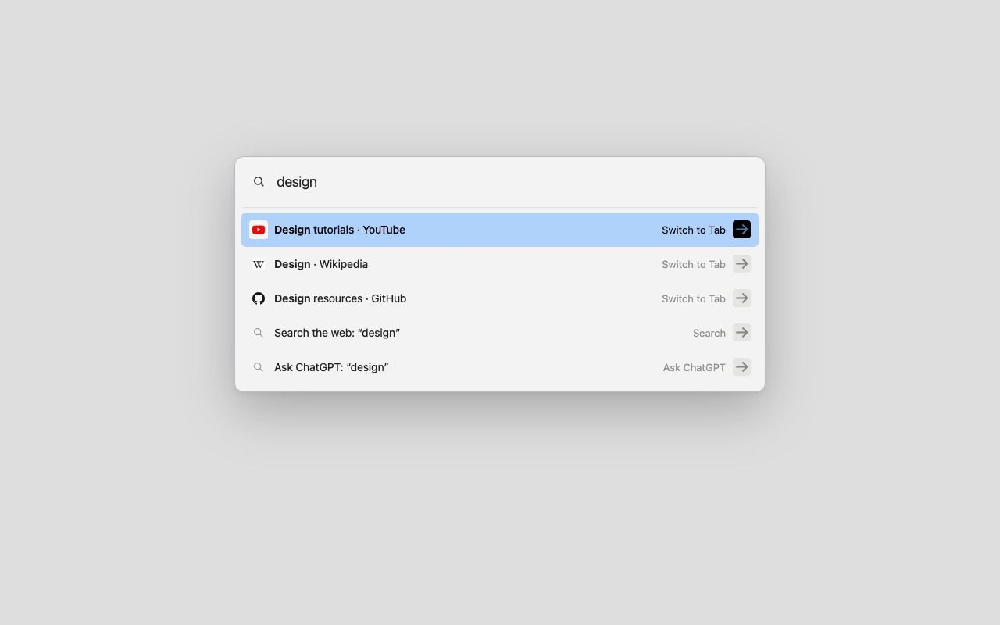

# Tablight

Find an open tab, switch back to your last one, or start a search—all from your keyboard.

## Install

1. Clone this repository or download and extract its ZIP.
2. Open `chrome://extensions`, enable **Developer mode**, and choose **Load unpacked** → the `extension/` folder.
3. Open **Options** for setup instructions. To use **⌘T**, assign it to **Activate the extension** at `chrome://extensions/shortcuts`.

The default shortcut is **⌘⇧Space** on Mac or **Ctrl⇧Space** elsewhere. You can also click the toolbar icon.

## Use

Type to find a tab. **↑ / ↓** selects, **Return** opens, and **Escape** closes. With no text, **Return** switches to your previous tab.

You can also open a URL, search with your default engine, or send a query to ChatGPT. Protected browser pages use a separate picker window.

Tab matching stays on your device. No telemetry or account required. Queries leave the browser only when you choose a web search or ChatGPT.

For troubleshooting, open **Options** → **Copy diagnostics**.

[Privacy, permissions, and development](docs/technical.md)
